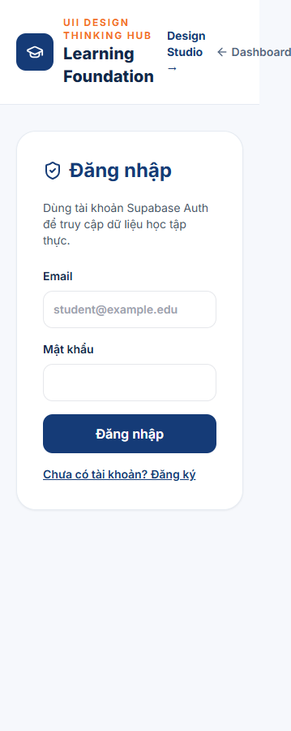
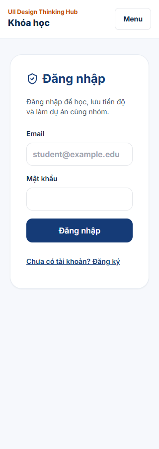

# UII Design Thinking Hub HCI and UX audit

Review date 2026-11-14, Asia/Bangkok. Baseline commit `ca5fb5e`, improvement branch `feat/production-learning-experience-20261114`. Issue [#11](https://github.com/anystuf/uii_design_thinking_hub/issues/11) confirms this baseline. This is an expert inspection with automated anonymous-page checks. Pilot observations and authenticated end-to-end acceptance remain pending.

## Nielsen heuristic scorecard

Scores are expert estimates out of 10. They describe the baseline source and observed screens, with 10 representing strongest conformance. They are not user-study measurements. Severity P0 blocks identity/data integrity, P1 blocks a core task, P2 creates significant friction, P3 is minor.

| Heuristic | Estimate | Evidence and affected screens | Severity | Remedy and progress |
| --- | --- | --- | --- | --- |
| Visibility of system status | 5 | Studio, Evidence and Review had unbounded session and API calls. Dashboard timeout is bounded but long. | P1 | Three workflow pages now share bounded requests and catch session failures. Add phase-specific loading and retry next. |
| Match with the real world | 4 | Releases, feature IDs, API, Supabase and snapshot terminology appear in learner pages. | P2 | Replaced prominent technical release copy on five screens with task guidance. Review remaining field terminology with students. |
| User control and freedom | 5 | Five design modes are revisitable. Existing lesson UI offered creation and publishing without an edit control. | P1 | Added lesson editing through the authorized update endpoint, preserving order. Add cancel/unsaved-work behavior to authoring. |
| Consistency and standards | 3 | Learning, Studio, Evidence, Review and Notifications used different headers and destination labels. | P2 | One shared navigation now covers these routes and the Admin directory. Dashboard still has its existing sidebar. |
| Error prevention | 6 | Services enforce ownership and immutability. Mobile forms and asynchronous selection need additional race checks. | P1 | Preserved service checks. Fixed read failures being presented as an empty account directory. Validate rapid selection and concurrent writes in UAT. |
| Recognition over recall | 4 | Students must infer the relationship between course, challenge, team, evidence and review. | P2 | Shared task labels and course empty-state guidance added. Contextual project/submission links remain needed. |
| Flexibility and efficiency | 4 | Every workflow initializes auth separately. Long lesson contents and videos all occupy one page. | P2 | Shared request policy and expandable lessons added. Session/profile deduplication remains pending. |
| Aesthetic and minimalist design | 5 | Course authoring and learning share one dense screen, with repeated headings and release labels. | P2 | Removed prominent release markers and collapsed lesson bodies. Dedicated student/lecturer layouts remain pending. |
| Help users recover from errors | 5 | Three screens surfaced raw upstream response bodies. Directory swallowed database exceptions. | P1 | Sanitized shared errors now cover all workflow requests. Directory propagates failures and Admin shows retry. Error messages still need task-specific language. |
| Help and documentation | 3 | No complete first-login guidance through learning, team creation and submission. | P2 | Added enrollment and project guidance. Onboarding journey and first-task pilot are pending. |

## Other HCI and learning criteria

| Framework | Finding | Acceptance criterion |
| --- | --- | --- |
| ISO 9241-11 effectiveness | Full learning-to-feedback task has no completed pilot evidence. | Record success/failure for each A–D scenario and role. |
| ISO 9241-11 efficiency | No measured time-to-first-task yet. Repeated session/profile initialization is visible in source. | Observe first task under one minute, measure five authenticated warm reads per endpoint. |
| ISO 9241-11 satisfaction | No learner satisfaction study performed. | Pilot interviews and a consistent post-task rating. |
| Cognitive load / Hick | Six destinations differ by screen, while advanced forms compete with learner content. | Stable destinations, one primary learner action, authoring disclosed by staff role. |
| Recognition / progressive disclosure | Lessons had fully expanded content and videos. | Expand relevant lesson while retaining curriculum overview. Implemented native details controls. |
| Fitts / mobile | Staging login header overflows at 320px. Studio contains 192/208px minimum-width fields inside cards. | All target widths pass overflow checks. Shared navigation and narrow-input changes implemented. |
| WCAG 2.2 AA | Keyboard, contrast, names, errors and target spacing require automated plus manual checks. | Axe findings recorded by route, keyboard/manual screen-reader checks pending. Skip link, focus outline, reduced motion and touch sizing added. |
| LXD | Five modes must remain nonlinear. Students need a learning-to-practice path. | Preserve modes, link course to challenge, show version-specific feedback. Full journey UAT pending. |

## Benchmarks consulted

- Khan Academy learner-home guidance exposes selected courses, resume points and visible progress. Adopt clear next actions and contextual progress. [Official guidance](https://support.khanacademy.org/hc/en-us/articles/115003342971-How-do-I-edit-the-My-Courses-section-on-my-Home-page)
- Coursera course detail exposes level, expected workload, module structure and enrollment. Adopt clear course orientation and a structured curriculum. [Course example](https://www.coursera.org/learn/learning-how-to-learn)
- Stanford d.school Bootleg presents practical methods across five revisitable modes. Preserve nonlinear mode navigation and contextual templates. [Official toolkit](https://dschool.stanford.edu/tools/design-thinking-bootleg)

## Screenshot evidence

Screenshots cover anonymous routes at desktop 1440, tablet 768 and mobile 320. They do not exercise authenticated authoring, taskboards or submissions. A local build/dev output collision invalidated an intermediate capture run. Those captures were replaced by a production-server run with a stylesheet assertion.

| Learning page | Before, deployed staging | After, local production build |
| --- | --- | --- |
| Mobile |  |  |
| Tablet | [Before](screenshots/2026-11-14/before/responsive-responsive-anonymous-screen-learn/screen-768.png) | [After](screenshots/2026-11-14/after/responsive-responsive-anonymous-screen-learn/screen-768.png) |
| Desktop | [Before](screenshots/2026-11-14/before/responsive-responsive-anonymous-screen-learn/screen-1440.png) | [After](screenshots/2026-11-14/after/responsive-responsive-anonymous-screen-learn/screen-1440.png) |

Other routes are captured in the adjacent screenshot directories. The baseline learning page failed the 320px horizontal-overflow assertion. The revised page passed the initial styled run at all eight widths. The final production-server run is recorded in Playwright results. Automated geometry alone does not establish mobile workflow usability.

## Measurements and verification

- Bounded session/API policy coverage expands to Studio, Evidence and Review, replacing three raw fetch wrappers. Mutations retain one network attempt.
- Five workflow headers now use one navigation component. Touch controls use a 44px minimum where practical, with 16px mobile form text.
- Baseline backend suite passed 49/49 tests. Frontend and backend builds passed. A new directory-failure regression test and lesson-editor browser fixture cover this iteration's changed behaviors.
- Local browser checks use Chrome, 900px height and widths 320, 360, 375, 390, 430, 768, 1024, 1440, without network or CPU throttling. The editor test uses isolated local API/session fixtures, not real staging identities.
- Current public staging probes from this workstation, five sequential samples each, normal network: `/health` 200 at 579/124/120/128/118ms, median 124ms, nearest-rank p95 579ms. `/health/ready` 200 at 184/124/131/123/122ms, median 124ms, p95 184ms. Anonymous `/auth/me` 401 at 116/118/116/115/115ms, median 116ms, p95 118ms. No authenticated timing or confirmed cold start was obtained in this run.
- LCP, CLS, INP, Slow 4G, concurrent load, real-device interaction and authenticated read p95 remain unmeasured. Next.js first-load JS stays roughly 165–174kB on private routes. This iteration has no claimed LCP/INP improvement.
- `npm audit` reports seven advisories including one critical advisory affecting Next.js. Dependency remediation and compatibility testing are a launch gate.

Final local results for this iteration: 50 backend tests pass, frontend/backend builds pass, and 9 Playwright tests pass. Browser coverage includes 64 anonymous route/width combinations and one local lecturer-editor fixture. Axe reports zero violations on the eight anonymous desktop states checked after correcting orange/white and muted-text contrast. Mobile keyboard/screen-reader and authenticated accessibility require further assessment. CI was extended for responsive screenshots and the staging PR branches, but its remote run is not yet verified.

## Prioritized implementation backlog and release gate

1. P1 security dependency remediation, verified staging authentication across refresh/logout, authenticated cross-role and cross-team negative tests.
2. Student onboarding, course discovery/detail, focused lesson player and progress, authenticated mobile screenshots and keyboard checks.
3. Challenge/team/task mobile journeys, unsaved activities, private upload byte verification, immutable versions and concurrent snapshots.
4. Dedicated lecturer console, rubric authoring/review, feedback/resubmission and notifications UAT.
5. Admin directory now uses authorized APIs. Role provisioning requires a backend endpoint, last-admin safeguards and durable audit history. Operational data requires authenticated backend reporting. These controls are pending implementation.
6. Shared session/request deduplication, measured waterfall reduction, LCP/CLS/INP and warm/cold API comparison.
7. CI lint/integration/E2E gates, backup restoration rehearsal, privacy/retention decisions, monitoring, pilot cohort and owner launch approval.

The mission remains in progress. This iteration establishes shared navigation, bounded workflow requests, lesson editing, an authorized Admin directory and a reproducible responsive harness. Full authenticated UAT, production operations and pilot acceptance are outstanding.
